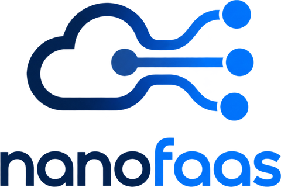

  <picture>
    <source media="(prefers-color-scheme: dark)" srcset="logo-dark.png">
    
  </picture>

  <b>A minimal, modular Function-as-a-Service control plane.</b> 
  Kubernetes · Docker · containerd/crun · GraalVM native · MIT

  <a href="https://nanofaas.github.io">Website</a> ·
  <a href="https://nanofaas.github.io/#quick-start">Quick start</a> ·
  <a href="https://github.com/Nanofaas/nanofaas/tree/main/docs">Docs</a> ·
  <a href="https://nanofaas.github.io/#recipes">Build your own NanoFaaS</a>

NanoFaaS registers, deploys and invokes containerized functions on Kubernetes or on a single host.
The control plane is one reactive Java service, and everything beyond invocation (queueing,
autoscaling, concurrency control, offloading, each deployment backend) is a module you choose at
build time.

NanoFaaS is developed at the [DatAI](https://unimib-datai.github.io/datai-website/) lab of the
[Department of Informatics, Systems and Communication (DISCo)](https://www.disco.unimib.it/en),
[University of Milano-Bicocca](https://www.unimib.it/).

### The platform

- [**nanofaas**](https://github.com/Nanofaas/nanofaas): control plane, CLI, function SDKs for Java, Python, Go, JavaScript and Rust, Helm chart
- [**nanolab**](https://github.com/Nanofaas/nanolab): operations CLI and end-to-end test tooling

### Building blocks

- [**containerd-java**](https://github.com/Nanofaas/containerd-java): Java client for containerd's native gRPC API, with no Docker, `ctr` or CRI in between
- [**libcni-java**](https://github.com/Nanofaas/libcni-java): Java port of libcni for invoking CNI plugins
- [**sonata**](https://github.com/Nanofaas/sonata): small, dependency-free workflow engine for Python

### Infrastructure SDKs

[multipass-vm-sdk](https://github.com/Nanofaas/multipass-vm-sdk) ·
[proxmox-vm-sdk](https://github.com/Nanofaas/proxmox-vm-sdk) ·
[azure-vm-sdk](https://github.com/Nanofaas/azure-vm-sdk) ·
[subprocess-toolkit](https://github.com/Nanofaas/subprocess-toolkit)

### Built with NanoFaaS

- [**weekpantry**](https://github.com/Nanofaas/weekpantry): recipe book, meal planner and shopping list running on k3s
